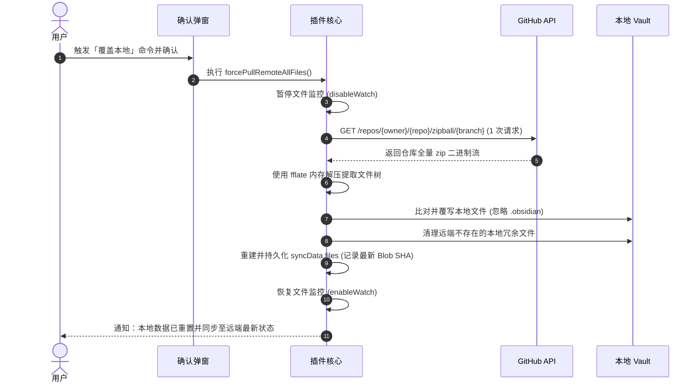
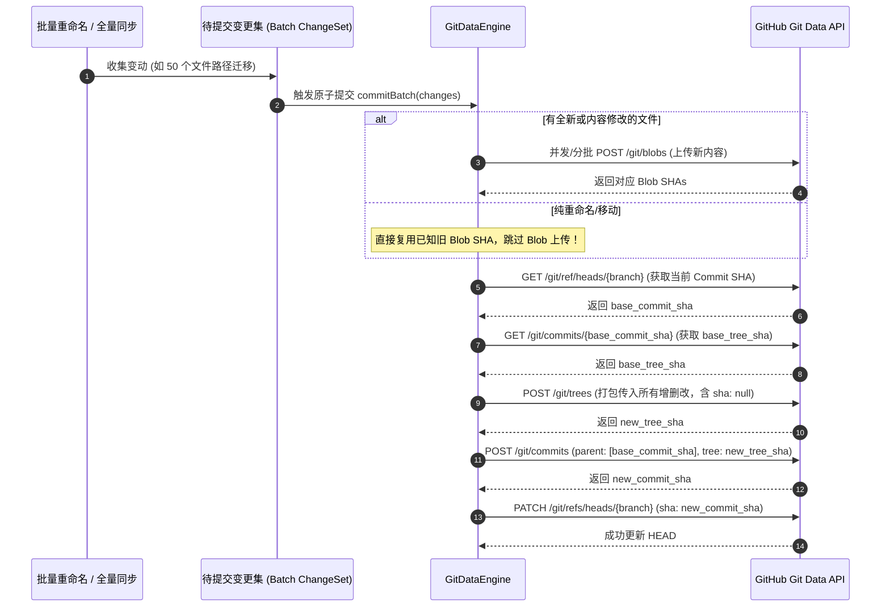

# 技术方案规范：批量提交引擎与覆盖本地初始化 (Spec)

- **版本**: v1.0.0
- **适用项目**: `obsidian-github-sync-multi-platform`
- **实施优先级**: 
  - **Phase 1**: 「仅下载初始化（覆盖本地）」命令与极速下载引擎
  - **Phase 2**: 基于 Git Data API 的批量原子提交引擎（根治 409 与 API 限流）

---

## 1. 背景与核心痛点

### 1.1 现状缺陷
1. **方向不对称**：插件当前仅有 `覆盖远端` 命令（`overrideRemoteAllFilesImpl`），缺失反向的 `覆盖本地`。在移动端初次安装、新设备初始化、或本地批量重命名混乱需回滚时，用户无法一键从 GitHub 同步干净的远端副本。
2. **Contents API 原罪**：当前修改、重命名、删除文件均调用 `/repos/{owner}/{repo}/contents/{path}`。该接口每操作 1 个文件就会自动创建 1 个 Git Commit 并推进分支 HEAD：
   - 移动包含 50 篇笔记的文件夹：触发 50 次 DELETE + 50 次 PUT = **100+ 次 HTTP 请求与 100 个提交**。
   - **409 Conflict 恶性循环**：连续提交极易遭遇 HEAD 指针竞争冲突，引发频繁重试与 API 额度枯竭（GitHub PAT 限制 5000 次/小时）。
   - **缺乏原子性**：中途断网或限流会导致文件夹“删了一半、建了一半”。

---

## 2. Phase 1：「仅下载初始化（覆盖本地）」设计规范

### 2.1 业务交互流程
1. **命令面板入口**：
   - 命令 ID: `download-force-init-all-files`
   - 显示名称: `$("同步全部笔记(覆盖本地/强制初始化)")`
2. **高危二次确认弹窗（Confirm Modal）**：
   - 触发时弹出 Obsidian Modal，明确警示：
     > **警告**：该操作将以 GitHub 远端仓库内容为准，强制覆盖本地笔记。本地未提交的修改或多余文件将被清理。
   - 提供 `取消` 与 `确认覆盖本地` 两个按钮（避免误触）。

### 2.2 核心下载引擎架构：Zipball API vs Tree 遍历

为了避免“下载 1000 个文件消耗 1000 次 API”的困境，采用 **Zipball API + 轻量纯 JS 解压（fflate）** 作为首选：



#### 关键技术点：
1. **依赖选型**：使用 `fflate`（约 8KB，纯 JS 实现，无 Node 依赖，在 iOS、Android 与桌面端均能高吞吐运行）。
2. **保护机制**：
   - 默认排除 `.obsidian/` 目录，防止覆盖用户本地自定义插件与主题配置（提供配置项）。
   - 分块或异步写入 Obsidian Vault，避免大库一次性写入导致 UI 卡顿。
3. **元数据重建**：
   - 写入本地的同时，根据文件内容计算本地 Git Blob SHA 并更新 `syncData.files`，保证后续 3-Way 同步无需全量重算。

---

## 3. Phase 2：「Git Data API 批量提交引擎」设计规范

### 3.1 核心概念转换
从单文件操作的 Contents API 切换为底层 Git 数据库对象：

| 动作 | 当前 (Contents API) | 新规范 (Git Data API) |
| :--- | :--- | :--- |
| **文件修改/新建** | `PUT /contents/{path}` | `POST /git/blobs` 生成 Blob SHA |
| **文件重命名/移动** | 逐个 `DELETE` + `PUT` 内容 | **复用原 Blob SHA**，仅在 Tree 中调整路径 |
| **文件删除** | `DELETE /contents/{path}` | 在 Tree 中传入该路径且设置 `sha: null` |
| **提交变动** | 每次调用自动生成 Commit | `POST /git/trees` $\to$ `POST /git/commits` $\to$ `PATCH /git/refs` |

### 3.2 批量提交工作流（以文件夹重命名/批量修改为例）



### 3.3 GitHubClient 扩展接口定义
```typescript
export interface GitTreeEntry {
  path: string;
  mode: "100644" | "100755" | "040000" | "160000" | "120000";
  type: "blob" | "tree" | "commit";
  sha: string | null; // null 表示在 base_tree 的基础上删除该路径
  content?: string;
}

export interface IGitDataClient {
  // 1. 创建独立 Blob (仅真正变动内容需要调用)
  createBlob(content: string | ArrayBuffer): Promise<string>;

  // 2. 基于 base_tree 构建新 Tree (单次请求可包含数千个文件的增/删/改/移动)
  createTree(baseTreeSha: string, treeEntries: GitTreeEntry[]): Promise<string>;

  // 3. 创建 Commit
  createCommit(message: string, treeSha: string, parentCommitSha: string): Promise<string>;

  // 4. 更新分支 Ref 指针
  updateRef(branch: string, commitSha: string, force?: boolean): Promise<void>;

  // 5. 获取指定 Ref 的最新 Commit SHA
  getRefCommit(branch: string): Promise<string>;

  // 6. 获取 Commit 对象对应的 Tree SHA
  getCommitTree(commitSha: string): Promise<string>;
}
```

### 3.4 事务防抖队列（Pending Change Queue）设计
针对用户在 Obsidian 中快速重命名多个文件、或者移动目录的情况：
- 引入 `PendingChangeQueue`：
  - 监听 Obsidian 事件，不立即逐个推 GitHub。
  - 将改动放入内存 Map：`Map<string, { type: 'add'|'modify'|'delete', content?: ... }>`。
  - 启动 3~5 秒防抖窗口。如果在 5 秒内有持续文件操作（如连环重命名），重置防抖计时器。
  - 防抖计时结束后，**整个 Queue 打包成一个 Git Tree，只产生 1 个 Commit 一次性推送到 GitHub**。

---

## 4. 效益预期与指标对比

| 场景 | 当前机制 (Contents API) | 新规范机制 (Git Data API + Zipball) | 收益提升 |
| :--- | :--- | :--- | :--- |
| **手机端首次拉取 1000 篇笔记** | 1000 次 GET 请求，易触碰并发限速 | **1 次 GET (Zipball)** 瞬间完成解压 | **API 消耗降低 99.9%** |
| **移动 50 篇笔记的文件夹** | 100~150 次 API (含 409 重试)，耗时 > 30s | **3~4 次 API**，耗时 1~2s | **API 消耗降 96%，速度提升 15 倍** |
| **409 冲突几率** | 高频触发（每个文件都在改分支 HEAD） | **趋近于 0**（只在最终更新 Ref 时一次性校验） | 彻底消除 409 恶性重试风暴 |
| **Git 提交历史** | 充斥海量单文件碎片化提交 | 每个批量动作仅产生 1 个清晰的 Commit | 仓库历史整洁可维护 |

---

## 5. 实施与分步路线图

### 第一阶段 (Phase 1)：覆盖本地初始化
1. 实现 `ConfirmModal` 二次确认弹窗组件。
2. 引入 `fflate` 并在 `GitHubClient` 中封装 `downloadZipball(branch)`。
3. 实现解压与写入 Vault 逻辑，构建 `syncData.files`，支持排除 `.obsidian`。
4. 注册 `$("同步全部笔记(覆盖本地/强制初始化)")` 命令及 UI 按钮。

### 第二阶段 (Phase 2)：Git Data API 批量提交引擎
1. 在 `GitHubClient` 中补齐 `createBlob`, `createTree`, `createCommit`, `updateRef` 等方法。
2. 实现 `batchCommit` 核心管线函数。
3. 重构 `NoteRename`（当重命名对象为 `TFolder` 时，直接走批量 Tree 路径，复用原 Blob SHA）。
4. 重构 `overrideRemoteAllFilesImpl`，全量推送到远端直接生成一个整树提交。
5. （可选增强）接入 `PendingChangeQueue` 实现多文件高频变更自动打包提交。
