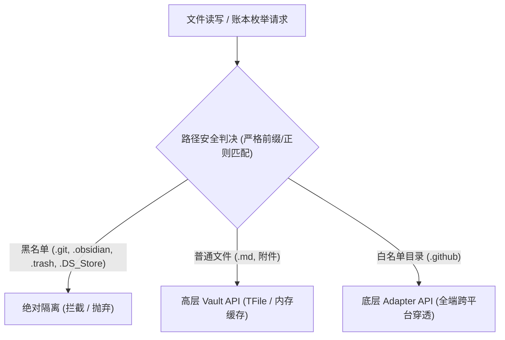

# 技术方案规范：统一存储桥接层与隐藏目录（.github）受控同步规范 (Spec)

- **版本**: v1.1.0 (经过 Google Production Readiness Review 生产就绪加固)
- **适用项目**: `obsidian-github-sync-multi-platform`
- **关联规范**: [SPEC_BATCH_SYNC_AND_INIT.md](file:///opt/project/obsidian-github-sync-multi-platform/docs/SPEC_BATCH_SYNC_AND_INIT.md)
- **定位**: 基础设施层 / 跨平台底层存储抽象规范

---

## 1. 背景与核心痛点

### 1.1 宿主 API 边界与“同步盲区”
Obsidian 内核对以 `.` 开头的隐藏目录（如 `.github/`、`.git/`、`.obsidian/`、`.trash/`）实施了黑盒级过滤机制：
1. **文件索引缺失**：`app.vault.getFiles()` 仅遍历普通知识库文件，任何隐藏目录均不返回对应的 `TFile` 对象。
2. **事件流静默**：`vault.on('create'|'modify'|'rename'|'delete')` 完全由内部元数据索引器派发。由于索引器不为隐藏目录建立节点，这些目录在磁盘上的任何修改**均不会触发任何事件**。

### 1.2 潜在的严重工程风险
当仓库中包含 `.github/workflows/` 等 DevOps 自动化配置时，现有逻辑会暴露两大致命隐患：
1. **远端工作流误删灾难（3-Way 对账缺陷）**：
   在 `syncAllFilesImpl` 逻辑中，当远端树中存在 `.github/workflows/deploy.yml` 且 `syncData.files` 中有历史追踪记录时，本地 `localFilesMap.get(path)` 因调用 `getFiles()` 返回 `undefined`，代码会误判**“本地已删除该文件”**，从而向 GitHub 派发 `DELETE` 请求，静默抹除远端 CI/CD 配置！
2. **目录创建报错崩溃（`ensureFolderExists` 缺陷）**：
   写入远端拉取的文件时，`ensureFolderExists` 调用 `vault.getAbstractFileByPath(".github")` 恒返回 `null`，导致重复触发 `vault.createFolder(".github")`。若磁盘已存在该文件夹，底层报错且 catch 中二次校验依然为 `null`，引发异常抛出（`throw e`），导致**整个初始化/同步主进程瞬间崩溃**。

---

## 2. 设计原则与边界约定



### 2.1 安全防波堤（Whitelist vs Blacklist）
为保护 3000+ 用户的个人隐私与核心配置，设立最高优先级安全检查机制：
* **受控白名单（WHITELIST_HIDDEN_DIRS）**：
  - 仅包含 `[".github"]`（严格前缀比对，忽略大小写）。
* **绝对黑名单（BLACKLIST_PATTERNS）**：
  - 严密正则匹配：`/^\.git(\/|$)/i`, `/^\.obsidian(\/|$)/i`, `/^\.trash(\/|$)/i`, `/(^|\/)\.DS_Store$/i`, `/(^|\/)Thumbs\.db$/i`。
  - 黑名单检查拥有**绝对否决权**。

### 2.2 事件机制决策：坚决放弃 `fs.watch` 与轮询
* **决策结论**：**不为隐藏目录增加实时监听通道**。
* **决策理由**：
  1. DevOps 配置属于极低频修改项，不存在高频按键即时同步诉求。
  2. 桌面端 `fs.watch` 跨平台行为差异极大（句柄泄露风险）；移动端（iOS/Android）无 Node 环境，轮询是严重的电池杀手。
  3. 符合 Git 本身的设计哲学：普通笔记保持事件驱动秒级同步，DevOps 配置文件收敛于**【手动同步 / 全量对账 / 启动自检 / 批量提交】**时统一扫描。

---

## 3. 架构规范：统一存储桥接层 (Storage Bridge Layer)

在 `src/lib/` 封装独立的跨平台统一存储工具（例如 `storage.ts`），提供 0 外部依赖、100% 跨平台（Desktop / iOS / Android）一致的原子能力。

### 3.1 统一账本条目定义
```typescript
export interface UnifiedSyncFile {
  path: string;           // 规范化 POSIX 路径 (如 .github/workflows/sync.yml)
  isMarkdown: boolean;    // 是否作为文本处理
  tFile?: TFile;          // 普通笔记保留 TFile 引用以优化性能；白名单文件此项为 undefined
}
```

### 3.2 核心方法契约 (PRR 强化版本)

#### 1. 严格路径安全判决
```typescript
import { Vault, TFile, normalizePath } from "obsidian";

export const MAX_FILE_SIZE = 10 * 1024 * 1024; // 10MB
export const WHITELIST_HIDDEN_DIRS = [".github"];

export const BLACKLIST_PATTERNS = [
  /^\.git(\/|$)/i,
  /^\.obsidian(\/|$)/i,
  /^\.trash(\/|$)/i,
  /(^|\/)\.DS_Store$/i,
  /(^|\/)Thumbs\.db$/i,
];

export function isPathBlocked(path: string): boolean {
  const normalized = normalizePath(path);
  return BLACKLIST_PATTERNS.some((pattern) => pattern.test(normalized));
}

export function isWhitelistedHiddenPath(path: string): boolean {
  const normalized = normalizePath(path);
  if (isPathBlocked(normalized)) return false;
  return WHITELIST_HIDDEN_DIRS.some(
    (dir) => normalized.toLowerCase() === dir || normalized.toLowerCase().startsWith(`${dir}/`)
  );
}
```

#### 2. 递归扫描白名单目录（带 10MB 检查、iOS 存在性守卫与单点异常隔离）
```typescript
export async function getWhitelistedHiddenFiles(vault: Vault): Promise<string[]> {
  const adapter = vault.adapter;
  const result: string[] = [];

  async function walk(dir: string) {
    try {
      // 关键守卫：iOS 下直接 list 不存在的文件夹会直接抛异常崩溃
      if (!(await adapter.exists(dir))) return;
      const listing = await adapter.list(dir);

      for (const filePath of listing.files) {
        const normalized = normalizePath(filePath);
        if (isPathBlocked(normalized)) continue;

        // P1 防御：移动端 OOM 防护，跳过 >10MB 大文件
        try {
          const stat = await adapter.stat(normalized);
          if (stat && stat.size > MAX_FILE_SIZE) {
            console.warn(`[Sync] Skipping large hidden file (>10MB): ${normalized}`);
            continue;
          }
        } catch {
          continue;
        }

        result.push(normalized);
      }

      for (const subDir of listing.folders) {
        const normalizedSub = normalizePath(subDir);
        if (!isPathBlocked(normalizedSub)) {
          await walk(normalizedSub);
        }
      }
    } catch (walkErr) {
      // P2 防御：单目录异常隔离，防止个别只读/损坏子目录打断全局同步
      console.warn(`[Sync] Failed to traverse hidden folder ${dir}:`, walkErr);
    }
  }

  for (const rootDir of WHITELIST_HIDDEN_DIRS) {
    await walk(rootDir);
  }
  return result;
}
```

#### 3. 全量文件账本提取 (`getAllVaultSyncFiles`)
```typescript
export async function getAllVaultSyncFiles(vault: Vault): Promise<Map<string, UnifiedSyncFile>> {
  const fileMap = new Map<string, UnifiedSyncFile>();

  // 1. 获取普通文件 (过滤超过 10MB 的大文件)
  for (const file of vault.getFiles()) {
    if (file.stat.size > MAX_FILE_SIZE) continue;
    if (isPathBlocked(file.path)) continue;

    fileMap.set(file.path, {
      path: file.path,
      isMarkdown: file.extension === "md",
      tFile: file,
    });
  }

  // 2. 补齐白名单隐藏文件
  const hiddenPaths = await getWhitelistedHiddenFiles(vault);
  for (const p of hiddenPaths) {
    fileMap.set(p, {
      path: p,
      isMarkdown: p.endsWith(".md"),
    });
  }

  return fileMap;
}
```

#### 4. 健壮的目录保障 (`safeEnsureFolderExists`)
```typescript
export async function safeEnsureFolderExists(vault: Vault, folderPath: string): Promise<void> {
  if (!folderPath || folderPath === "/" || folderPath === ".") return;
  const normalized = normalizePath(folderPath);
  const adapter = vault.adapter;
  const parts = normalized.split("/");
  let current = "";

  for (const part of parts) {
    current = current ? `${current}/${part}` : part;
    // 真理源以底层 adapter.exists 为准，彻底根治隐藏目录重复创建报错
    if (await adapter.exists(current)) continue;

    if (current.startsWith(".") || current.includes("/.")) {
      await adapter.mkdir(current);
    } else {
      await vault.createFolder(current);
    }
  }
}
```

#### 5. 安全读写与删除抹平（带孤儿空目录自动清理）
```typescript
export async function safeReadSyncFile(vault: Vault, entry: UnifiedSyncFile): Promise<ArrayBuffer> {
  if (entry.tFile) {
    return await vault.readBinary(entry.tFile);
  }
  return await vault.adapter.readBinary(entry.path);
}

export async function safeWriteSyncFile(
  vault: Vault,
  path: string,
  buffer: ArrayBuffer,
  isMarkdown: boolean
): Promise<void> {
  const normalized = normalizePath(path);
  if (isPathBlocked(normalized)) {
    throw new Error(`Security Violation: Blocked writing to blacklisted path: ${normalized}`);
  }

  const folder = normalized.split("/").slice(0, -1).join("/");
  if (folder) {
    await safeEnsureFolderExists(vault, folder);
  }

  if (isWhitelistedHiddenPath(normalized)) {
    // 白名单隐藏文件走 adapter 写入
    await vault.adapter.writeBinary(normalized, buffer);
  } else {
    // 普通文件优先走 TFile
    const existing = vault.getAbstractFileByPath(normalized);
    if (existing instanceof TFile) {
      if (isMarkdown) {
        await vault.modify(existing, new TextDecoder().decode(buffer));
      } else {
        await vault.modifyBinary(existing, buffer);
      }
    } else {
      if (isMarkdown) {
        await vault.create(normalized, new TextDecoder().decode(buffer));
      } else {
        await vault.createBinary(normalized, buffer);
      }
    }
  }
}

export async function safeDeleteSyncFile(vault: Vault, path: string): Promise<void> {
  const normalized = normalizePath(path);
  const existing = vault.getAbstractFileByPath(normalized);

  if (existing) {
    await vault.delete(existing);
  } else if (isWhitelistedHiddenPath(normalized) && (await vault.adapter.exists(normalized))) {
    await vault.adapter.remove(normalized);

    // 自动向上递归清理白名单空父目录
    let parent = normalized.split("/").slice(0, -1).join("/");
    while (parent && isWhitelistedHiddenPath(parent)) {
      try {
        const parentListing = await vault.adapter.list(parent);
        if (parentListing.files.length === 0 && parentListing.folders.length === 0) {
          await vault.adapter.rmdir(parent, false);
          parent = parent.split("/").slice(0, -1).join("/");
        } else {
          break;
        }
      } catch {
        break;
      }
    }
  }
}
```

---

## 4. 业务链路改造清单

### 4.1 覆盖本地初始化 (`forcePullRemoteAllFilesImpl`)
1. **解压过滤**：保留 `.github/` 下的有效文件，解压时不被默认黑名单拦截。
2. **孤儿删除**：比对基准从 `vault.getFiles()` 切换为 `getAllVaultSyncFiles()`，清理本地冗余文件时统一调用 `safeDeleteSyncFile`。
3. **文件写入**：写入调用 `safeWriteSyncFile`，并立即计算 `computeGitBlobSha` 写入 `syncData.files[path]`。

### 4.2 覆盖远端 (`overrideRemoteAllFilesImpl`)
1. **收集账本**：遍历清单从 `vault.getFiles()` 切换为 `getAllVaultSyncFiles()`。
2. **状态比对**：`.github` 下的脚本与配置一视同仁计算 SHA，发生变动正常推送到远端。

### 4.3 经典双向对账 (`syncAllFilesImpl`)
1. **彻底排雷**：`localFilesMap` 使用 `getAllVaultSyncFiles()` 初始化，避免远端 `.github` 被误判为“本地已删除”。
2. **下载与写入**：统一使用 `safeWriteSyncFile` 与 `safeDeleteSyncFile`。

---

## 5. 多平台验证矩阵 (Test Matrix)

| 测试平台 | 测试项目 | 预期结果 |
| :--- | :--- | :--- |
| **macOS / Linux** | 包含 `.github/workflows/ci.yml` 的全量覆盖与双向对账 | 工作流文件正常同步，本地与远端 SHA 对齐 |
| **Windows** | 包含多层子目录的 `.github/actions/test/action.yml` | 路径统一为正斜杠 `/`，GitHub 远端树结构无反斜杠错乱 |
| **iOS / Android** | 本地无 `.github` 目录时执行同步初始化 | 触发 `adapter.exists` 守卫，无任何崩溃异常弹窗 |
| **普通笔记场景** | 正常编辑 `.md`、插入图片附件 | `NoteModify` 防抖实时增量同步正常运行，毫无性能衰减 |
