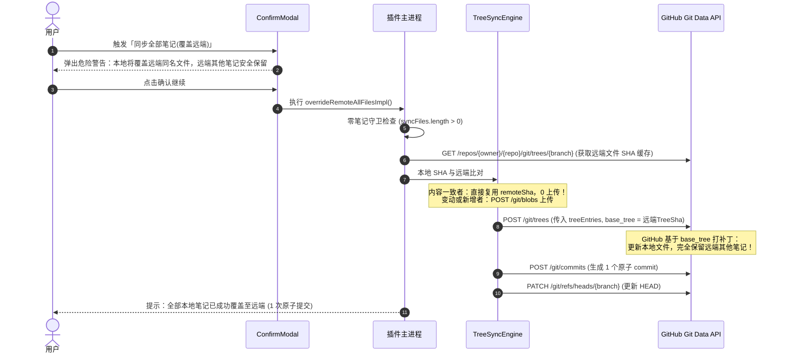

# 技术方案规范：覆盖远端语义重构与多端防灾安全熔断引擎 (Spec)

- **版本**: v1.2.0 (二次深度审计加固版)
- **适用项目**: `obsidian-github-sync-multi-platform`
- **实施优先级**: 
  - **P0（致命级/紧急）**: 纠正“覆盖远端”核心逻辑为 Upsert（保留远端 `baseTreeSha`）+ 命令面板高危二次确认弹窗
  - **P0（致命级/紧急）**: 双向同步（3-Way Sync）全链路大面积删除安全熔断门限（Circuit Breaker），切断多端级联删除雪崩链条
  - **P0（致命级/紧急）**: 修复实时监听 `NoteDelete` 文件夹删除后门，引入批量删除确认与原子提交，严禁循环 DELETE API 洪峰
  - **P1（重要）**: 零笔记保护（Zero-Note Guard）与强制覆盖本地（forcePull）远端缩水熔断防护
  - **P1（重要）**: 熔断终止时的事务原子回滚（保证 `syncData.files` 不受污染，且不卡死后台同步锁）

---

## 1. 背景与事故根因深度分析 (Post-Mortem & Vulnerability Analysis)

### 1.1 事故经过与级联雪崩链条
在多设备（Windows + Mac）协同场景下，发生了一起导致远端 GitHub 仓库与本地设备全量笔记被清空的严重事故：
1. **Windows 端误操作**：用户在 Windows 端清理或误删了 Obsidian 本地笔记目录（此时本地有效文件为 0 或极少数残留）；
2. **触发“覆盖远端”**：用户在 Obsidian 命令面板中执行了 `同步全部笔记(覆盖远端)`；
3. **远端整库被抹除**：远端 GitHub 仓库中原有的成百上千篇笔记在 1 秒内被全部抹除，HEAD 分支推进到一个空树提交；
4. **Mac 端级联清空**：用户在 Mac 上启动 Obsidian，插件自动触发启动全量同步（`StartupFullNotesSync`）。Mac 端检测到远端仓库已没有这些文件，将其误判为“已在其他设备删除”，随即自动调用本地删除接口，**将 Mac 本地所有的真实笔记也全部彻底删除**！


### 1.2 漏洞根因 1：`explicitBaseTreeSha: null` 导致整库镜像抹除
在 [`src/lib/fs.ts`](file:///opt/project/obsidian-github-sync-multi-platform/src/lib/fs.ts) 的 `overrideRemoteAllFilesImpl` 实现中：
```typescript
// 历史旧代码缺陷
await plugin.githubClient.commitBatch(
  `sync: override remote with all local assets (${syncFiles.length} files)`,
  treeEntries,
  null // 💥 致命根因：传 null 强制以空树为根！
);
```
在 GitHub Git Database API (`POST /repos/{owner}/{repo}/git/trees`) 中：
- 若提供 `base_tree`：GitHub 将基于已有树结构进行打补丁（增量更新与追加，原有文件保留）；
- 若传 `base_tree: null`：GitHub 将以**绝对的空树（0 文件）**为根。所有不在 `treeEntries` 中的已有文件会被**全部删除**。
开发者原意是“自动清理远端孤儿文件”，但在本地空库、误删、或新设备未初始化场景下，该逻辑造成了毁灭性的“整库抹杀”。

### 1.3 漏洞根因 2：破坏性命令缺乏二次确认交互
- `同步全部笔记(覆盖本地/强制初始化)` 拥有 `ConfirmModal` 警告弹窗；
- 而同样具有破坏性的 `同步全部笔记(覆盖远端)` 却没有任何二次确认弹窗，用户在命令面板中敲击回车即刻触发，容错率为 0。

### 1.4 漏洞根因 3：双向同步缺失“批量删除安全熔断门限”
在 [`src/lib/fs.ts`](file:///opt/project/obsidian-github-sync-multi-platform/src/lib/fs.ts) 的 `syncAllFilesImpl` 中：
- **步骤 1**：如果本地 `syncData.files` 记录的文件在远端不存在，直接调用 `safeDeleteSyncFile` 将本地文件删除；
- **步骤 2**：如果远端记录的文件在本地不存在，直接调用 `deleteFile` 将远端文件删除。
整套逻辑**没有任何批量删除安全门限**。只要某一端出现数据骤降，系统便忠实地执行静默级联删除，直接引发全网雪崩。

### 1.5 漏洞根因 4（二次审计新发现）：`NoteDelete` 文件夹删除的独立后门
在实时文件事件监听中，当用户删除文件夹（`file instanceof TFolder`）时，代码遍历子文件并循环发送单文件 `deleteFile` 请求。不仅缺乏任何数量确认保护，一旦误删文件夹将直接把远端同步清空，且会因高频并发触发 GitHub 403 API 限流。

---

## 2. 设计原则与核心目标 (Core Principles & Objectives)

1. **安全默认（Fail-Safe Default）**：
   - 系统的默认防线必须是“宁可暂停同步并报错，也绝不容许错误删除任何数据”。
2. **语义纠正：覆盖远端 = Upsert（增量覆写）**：
   - “覆盖远端”的核心语义是：**以本地版本强制覆盖远端同名文件，并推送本地新增文件**；
   - **本地没有、但远端存在的文件，必须百分之百完好保留**，严禁以本地空目录格式化远端。
3. **保持 Tree 模式与 API 额度极致节约**：
   - 必须继续沿用 Git Data API 的 Tree 批量打包能力（`createTree` + `createCommit` + `updateRef`）；
   - 保持基于 Git SHA 的本地对比机制，未修改文件继续享受 **0 上传流量消耗**；
   - 全量同步单次提交仅消耗 2~3 次 GitHub API 请求，确保不会耗尽 GitHub 5000 次/小时的 PAT 配额。
4. **全链路对称熔断体系（Bilateral Circuit Breaker）**：
   - 建立大面积删除熔断拦截，切断“单端清空 $\to$ 全端雪崩”的级联反应。
5. **本地删除强制软删除（Trash Protection）**：
   - 任何由同步逻辑触发的本地删除操作，必须走回收站/废纸篓（`vault.trash`），严禁底层直接硬物理擦除。

---

## 3. 核心功能模块详细设计

### 3.1 覆盖远端重构：由 Mirror 改为 Upsert

#### 3.1.1 核心改动点
在 `overrideRemoteAllFilesImpl` 中：
1. **移除 `explicitBaseTreeSha: null`**：
   - 改为不传或传入远端当前的 `baseTreeSha`；
   - 底层 `commitBatch` 自动基于远端父 Commit 的 `tree.sha` 作为 `base_tree`；
   - GitHub Git Data API 收到请求后，会在已有树基础上将本地变动/新增文件打补丁，**远端已有的其他全部文件百分之百安全保留**！
2. **零笔记安全拦截（Zero-Note Guard）**：
   在开始处理前检查本地有效笔记数：
   ```typescript
   if (syncFiles.length === 0) {
     new Notice($("本地未检测到有效笔记，已终止覆盖远端以保护数据安全！"));
     return;
   }
   ```
3. **命令调用入口接入 ConfirmModal**：
   在 [`src/main.ts`](file:///opt/project/obsidian-github-sync-multi-platform/src/main.ts#L94-L98) 中为 `init-all-files` 增加红色高危警告弹窗，必须用户显式点击确认才可执行。
4. **元数据（syncData.files）平滑合并**：
   执行覆盖远端后，不能将 `syncData.files` 粗暴清空重置为仅包含本地文件；而应采用增量覆写方式合并（保留远端已存在文件的缓存状态），避免下次双向同步产生认知偏差。

#### 3.1.2 Upsert 批量提交时序流程


---

### 3.2 核心防灾体系：安全熔断机制 (Safety Circuit Breaker)

为了杜绝“某端误删或被清空，导致启动同步时清空其他设备”的惨剧，在双向同步与批量处理中引入**安全熔断保护**。

#### 3.2.1 熔断门限定义 (Threshold Definition)
任何自动化同步过程，待删除的文件集 $D$ 满足以下任一条件时，即判定为**高危批量删除**：
1. **绝对数量门限**：待删除文件数 $|D| \ge 5$；
2. **相对比例门限**：待删除文件数占总受跟踪文件比例 $\ge 30\%$ 且 $|D| \ge 2$。

#### 3.2.2 熔断行为与事务状态管理（二次审计加固）
1. **双向同步步骤 1（远端缺失，触发本地删除保护）**：
   - 若待删除本地文件集触碰熔断门限：
     - **严禁静默执行本地删除**；
     - **立即安全释放后台同步锁（`plugin.isSyncInProgress = false` 并恢复 watch）**，防止用户未响应弹窗导致后台死锁无法保存后续笔记！
     - 弹出阻塞式告警弹窗（`CircuitBreakerModal`）：
       > **【安全熔断警报】检测到远端有 X 个笔记已被删除！**  
       > 为防止多端误删或远端误操作引发数据雪崩，系统已自动暂停删除本地文件。  
       > 若这是您在其他设备的正常删除操作，请点击“确认在本地同步删除”；否则请点击“保留本地文件并取消”。
     - 若用户未确认或关闭弹窗，**默认事务回滚：不修改 `syncData.files`，本地文件完整保留**。
2. **双向同步步骤 2（本地缺失，触发远端删除保护）**：
   - 若本地缺失的历史跟踪文件数触碰熔断门限：
     - **严禁静默批量调用 `githubClient.deleteFile`**；
     - 弹出警报弹窗让用户核验，防止本地误删目录导致远端连带被删；未确认前远端分毫不动。
3. **`NoteDelete` 文件夹实时监听熔断加固**：
   - 当检测到删除的是文件夹（`file instanceof TFolder`）且受影响子文件数 $\ge 5$ 时：
   - 触发二次确认弹窗，禁止直接触发多并发 DELETE 循环；确认后改用 Git Data API 单次原子提交删除，防止 API 限流和脏状态。
4. **强制覆盖本地（forcePull）远端有效性校验**：
   - 在解压远端 zipball 后，如果提取出的有效文件数量为 0，或比本地当前笔记少 70% 以上且本地笔记 $> 5$ 篇：
   - 触发熔断阻断，提示：“远端快照数据异常缩水（仅 X 个文件），已中止覆盖本地，避免本地笔记丢失！”

---

### 3.3 本地删除安全防护（软删除机制）

修改 [`src/lib/storage.ts`](file:///opt/project/obsidian-github-sync-multi-platform/src/lib/storage.ts) 中的 `safeDeleteSyncFile`：
- 将原本的硬删除逻辑：
  ```typescript
  // 危险：硬删除可能直接绕过废纸篓
  await vault.delete(existing);
  ```
- 改造为**强制走 Obsidian 软删除（Trash API）**：
  ```typescript
  // 安全加固：强制移入系统废纸篓或 .trash 目录，确保物理可逆
  await vault.trash(existing, true);
  ```
- 确保即使在极端意外情况下发生误删，用户也可以随时在系统废纸篓中“一键放回”，提供终极实体安全保障。

---

## 4. API 消耗与性能额度保障规范

| 指标 | 目标要求 | 实现策略 |
| :--- | :--- | :--- |
| **API 消耗 (全量覆写远端)** | $\le 3$ 次 HTTP 请求 (若内容无变化) | 1 次获取 Tree + 1 次创建 Tree + 1 次创建 Commit + 1 次更新 Ref |
| **网络流量 (全量覆写远端)** | 0 额外流量（对于未修改文件） | 本地先行计算真实 Git SHA，远端已存在则仅复用 SHA 引用 |
| **原子性保证** | 1 个独立 Git Commit | 整个库的覆盖变动打包为单次 Commit，避免 409 竞争冲突与脏状态 |
| **API 额度安全** | 远低于 GitHub 5000 次/小时限制 | 批量提交完全杜绝任何基于 Contents API 的逐文件循环提交 |

---

## 5. UI/UX 交互与国际化规范 (i18n)

### 5.1 命令文案与警告弹窗文案
1. **命令名称**：
   - `zh-cn`: `同步全部笔记(覆盖远端)`
   - `en`: `Sync all notes (overwrite remote)`
2. **二次确认弹窗（ConfirmModal）**：
   - **标题**: `覆盖远端确认` / `Confirm Overwrite Remote`
   - **内容**: 
     > 警告：此操作将把本地笔记强制上传并覆盖 GitHub 远端同名文件！远端已存在但本地没有的文件将被安全保留。确定要继续吗？
     > (Warning: This operation will upload local notes and overwrite identical files on GitHub remote! Files that exist on remote but not locally will be safely preserved. Are you sure you want to proceed?)
   - **确认按钮**: `确认覆盖远端` (红底高危样式)
   - **取消按钮**: `取消`

### 5.2 熔断弹窗文案 (Circuit Breaker Modal)
- **标题**: `🚨 安全熔断拦截：检测到批量文件删除` / `🚨 Circuit Breaker: Mass Deletion Detected`
- **内容**: 
  > 系统检测到有 {count} 个文件即将被批量删除（超过安全保护阈值）。为防止误操作或网络异常导致多端数据丢失，同步已暂停。请确认是否继续删除？
- **选项**:
  - `中止操作并保留文件 (推荐)` (默认焦点)
  - `确认批量删除` (次级按钮/高危样式)

---

## 6. 测试用例与验证矩阵 (Verification Matrix)

| 用例 ID | 测试场景 | 预期结果 |
| :--- | :--- | :--- |
| **TC-01** | 本地清空笔记后，触发“覆盖远端” | 触发零笔记保护，弹出错误 Notice，**远端文件分毫未损** |
| **TC-02** | 本地仅有 1 篇新笔记，远端有 100 篇旧笔记，执行“覆盖远端” | 新笔记成功推送到远端，**远端原有的 100 篇旧笔记完整保留** |
| **TC-03** | 本地修改 2 篇笔记，执行“覆盖远端” | 远端 2 篇笔记被更新，未修改的文件 0 上传直接复用，只生成 1 个 Commit |
| **TC-04** | 远端被意外清空（0 文件），本地启动 Obsidian 双向同步 | 触发熔断保护，弹出拦截警告，**本地文件绝不被静默删除** |
| **TC-05** | 本地误删 20 篇笔记，启动双向同步 | 触发本地删除远端熔断警告，用户未确认则**远端文件绝不被删除** |
| **TC-06** | 正常单文件删除（删除 1 篇笔记）并同步 | 小于门限值（< 5），正常执行常规同步，无需弹出熔断扰民 |
| **TC-07** | 本地删除包含 10 个子文件的文件夹 | 触发文件夹删除确认，避免高频并发 API 限流 |
| **TC-08** | 发生本地删除时检查垃圾桶 | 被删除文件完整进入 Obsidian 回收站 / 系统废纸篓，支持一键放回 |
